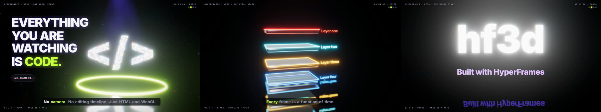

# media-stack

**EN (short):** self-hosted video/presentation generation stack behind a single signed HTTP API (`POST /v1/jobs` -> 202). HyperFrames (HTML to MP4) for rendering, ElevenLabs Eleven v3 via fal.ai for voice with automatic Piper (local, free) fallback, Pexels stock photos/videos, procedural music and SFX, Whisper captions. Docker Compose, amd64, no GPU. MIT-licensed glue code; third-party components keep their licenses (see below). Docs are in Portuguese (PT-PT). Plus a local studio toolkit: **hf3d**, a deterministic three.js kit for HyperFrames (neon, reflections, glass, water, GPU particles, GLSL scene transitions), and **local audio** (Kokoro voice, Stable Audio Open music, numpy SFX, whisper.cpp word timing, -14 LUFS mix and QA).

---

Geracao de **videos** (Reels/Shorts 9:16, 16:9, quadrado) e **apresentacoes** a partir de um pedido JSON, atras de uma API unica assinada. Foi desenhada para ser chamada por uma app (ex. uma app Laravel com filas) que cria os pedidos, recebe o MP4 e o publica; esta stack so **produz** o media.

## Duas formas de usar

| | API (Docker Compose) | Estúdio local (3D) |
|---|---|---|
| Para | vídeos a partir de um pedido JSON, chamados por uma app | vídeos à medida com cenas 3D a sério |
| Render | `render-hyperframes` (HTML + GSAP) | HyperFrames + kit [`packages/three-kit`](packages/three-kit/README.md) (three.js) |
| Voz | fal.ai Eleven v3, com fallback Piper | Kokoro-82M local ([`local-audio`](local-audio/README.md)) |
| Música / SFX | procedural (numpy) | Stable Audio Open local + SFX numpy |
| Stock | Pexels | nenhum: tudo gerado em código |
| Começar por | secção "Instalacao rapida" | [`templates/showcase-3d`](templates/showcase-3d/README.md) e [`docs/WORKFLOW-3D.md`](docs/WORKFLOW-3D.md) |



## Arquitectura

```
 app cliente (fila/jobs)                       VM amd64 (Docker Compose, sem GPU)
 ┌──────────────────┐   POST /v1/jobs (HMAC)   ┌──────────────────────────────────────────┐
 │ cria pedido      │ ───────────────────────▶ │ gateway :8080  (202, estado, tectos, QA) │
 │ guarda idem. key │ ◀── 202 {id} ──────────  └───┬───────┬────────┬────────┬───────┬────┘
 │                  │                              │       │        │        │       │
 │ POST callback    │ ◀── callback assinado ───    ▼       ▼        ▼        ▼       ▼
 │ (ou GET /jobs/id)│                          tts-local music-gen sfx-gen stt-whisper mixer
 └──────────────────┘                          (Piper)  (procedural)       (faster-    (FFmpeg)
        ▲                                         │                         whisper)      │
        │  GET /v1/jobs/:id/output                └──────────┬─────────────────┘         │
        └───────────────────────────────────────  render-hyperframes (Chromium + FFmpeg) ◀┘
                                                   fal.ai (voz) · Pexels (stock) — chamadas de saida do gateway
```

| Servico | Funcao |
|---|---|
| `gateway` | API, HMAC, idempotencia, estado em ficheiros (`/state`), pipeline, callback assinado, QA, tectos de custo da voz |
| `render-hyperframes` | HTML + GSAP -> MP4 (HyperFrames 0.8.138, Chromium, FFmpeg); inclui o kit 3D `hf3d` (three.js) e WebGL por SwiftShader para o kind `video3d` |
| `tts-local` | Piper `pt_PT-tugao-medium` (fallback gratuito, CPU) |
| `tts-qwen` (perfil `qwen`) | **voz fixa**: Qwen3-TTS (Apache-2.0) em modo clone a partir de um voice pack montado só de leitura (`TTS_PROVIDER=qwen`, `DEFAULT_VOICE`). Se falhar, cai no Piper. Ver [local-audio/README.md](local-audio/README.md#voz-fixa-voice-pack--qwen3-tts) |
| `music-gen`, `sfx-gen` | musica de fundo e efeitos procedurais (numpy, CPU, sem modelos) |
| `stt-whisper` | legendas palavra-a-palavra (faster-whisper `base`, CPU) |
| `mixer` | mistura (ducking, loudnorm -14 LUFS), normaliza clips de fundo, QA pos-render |
| `models` | one-shot: descarrega modelos (Piper, Whisper) para o volume `/models` |

Modelos **nunca** ficam dentro das imagens; vivem no volume `models`.

## Requisitos
- VM **linux/amd64**, Debian 12 / Ubuntu 22.04+; **16 vCPU, 32 GB RAM, 400 GB SSD** recomendado (minimo 8 vCPU / 16 GB / 200 GB). **Sem GPU.**
- Docker Engine 24+ com `docker compose` v2.
- Saida HTTPS para `fal.run`, `api.pexels.com`, `images.pexels.com`, `videos.pexels.com`, `huggingface.co` (1.o download dos modelos).
- Contas/chaves: fal.ai (`FAL_KEY`), Pexels (`PEXELS_API_KEY`).

## Instalacao rapida
```bash
git clone https://github.com/digitaldev-lx/media-stack && cd media-stack && git checkout v1.0.0
cp .env.example .env && chmod 600 .env          # preencher (ver tabela abaixo)
docker compose build
docker compose --profile tools run --rm models piper_pt whisper_base
docker compose up -d && docker compose ps       # todos healthy
set -a; . ./.env; set +a
scripts/smoke.sh scripts/example-reel-pt-local.json     # teste sem chaves externas (Piper)
```
Guia detalhado (firewall, backup, checklist de aceitacao): [INSTALAR.md](INSTALAR.md).

## Variaveis de ambiente (`.env`)
| Variavel | Descricao |
|---|---|
| `MEDIA_HMAC_SECRET` | **Obrigatoria.** Segredo partilhado para assinar pedidos e callbacks (`openssl rand -hex 32`) |
| `FAL_KEY` | Chave fal.ai para a voz. Sem ela, fallback automatico para Piper |
| `PEXELS_API_KEY` | Chave Pexels (fotos/videos de stock) |
| `TTS_PROVIDER` | `fal` (omissao) ou `local` |
| `TTS_FALLBACK` | `local`: se a fal falhar/sem saldo/tecto excedido, usa Piper |
| `FAL_TTS_MODEL` | `fal-ai/elevenlabs/tts/eleven-v3` |
| `FAL_VOICE` | `voice_id` ElevenLabs (escolher voz PT-PT) |
| `FAL_LANGUAGE_CODE`, `FAL_STABILITY` | `pt`; estabilidade 0-1 opcional |
| `FAL_TTS_USD_PER_1K_CHARS` | Preco usado para estimar o custo (confirmar no fal.ai) |
| `FAL_MAX_USD_PER_JOB`, `FAL_MAX_USD_PER_DAY` | Tectos de custo; excedidos -> fallback local |
| `BIND_IP` | IP onde a API escuta (VPN/rede privada; nunca `0.0.0.0`) |
| `CALLBACK_ALLOWED_HOSTS` | Hosts (https) autorizados a receber callbacks. Vazio = callbacks desligados |
| `ASSET_ALLOWED_HOSTS` | Hosts autorizados para descarregar imagens/videos |
| `RENDER_CPUS`, `RENDER_MEM`, `MAX_CONCURRENT_JOBS`, `JOB_TTL_HOURS`, `WHISPER_MODEL` | Recursos e retencao |

## API
Todos os pedidos (excepto `/health`) levam `X-Timestamp` (unix, janela de 5 min) e `X-Signature: sha256=<hex>`, onde

```
hex = HMAC_SHA256( MEDIA_HMAC_SECRET, "<timestamp>.<METODO>.<caminho+query>.<corpo bruto>" )
```

Exemplo em shell (`scripts/post-job.sh` faz isto por si):
```bash
BODY='{"kind":"video","spec":{"format":"vertical","voice":{"provider":"local"},"scenes":[{"narration":"Ola mundo."}]}}'
TS=$(date +%s)
SIG=$(printf '%s' "${TS}.POST./v1/jobs.${BODY}" | openssl dgst -sha256 -hmac "$MEDIA_HMAC_SECRET" -hex | sed 's/^.* //')
curl -X POST http://127.0.0.1:8080/v1/jobs -H 'content-type: application/json' \
  -H "X-Timestamp: $TS" -H "X-Signature: sha256=$SIG" -H "Idempotency-Key: $(uuidgen)" --data-binary "$BODY"
# -> 202 {"id":"<uuid>","status":"queued"}
```
- `GET /v1/jobs/:id` -> `status` (`queued` | `running` + `step` | `succeeded` | `failed`), `result` (output, QA, avisos, `fal_usd`, creditos Pexels) ou `error`.
- `GET /v1/jobs/:id/output` -> MP4/WAV (assinado, com o caminho no texto assinado).
- **Idempotencia:** a mesma `Idempotency-Key` devolve o mesmo job (`deduplicated: true`).
- **Callback:** com `callback_url` (https, host em `CALLBACK_ALLOWED_HOSTS`) o gateway faz `POST` do resultado com `X-Timestamp`, `X-Signature`, `X-Job-Id` (mesma assinatura, caminho do URL de callback), ate 5 tentativas com backoff. Quem recebe deve verificar a assinatura com `hash_equals`/comparacao de tempo constante e rejeitar timestamps com > 5 min. Se o callback se perder, reconciliar com `GET /v1/jobs/:id`.
- `output.put_url` (opcional, presigned PUT de um bucket S3-compativel) faz o gateway enviar o MP4 directamente.

### Spec (resumo)
```json
{
  "format": "vertical | horizontal | square",
  "voice":   { "provider": "fal | local", "voice": "<voice_id>", "language_code": "pt" },
  "music":   { "prompt": "calm corporate", "volume": 0.28 },
  "sfx":     [ { "type": "whoosh", "at": 3.2 } ],
  "captions": "scene | words",
  "scenes": [
    { "title": "Titulo", "narration": "Texto falado",
      "stock": { "query": "office desk", "type": "video | photo" } },
    { "title": "Slide", "bullets": ["a", "b"], "layout": "slide", "narration": "..." }
  ]
}
```
`kind`: `video`, `presentation`, `video3d` (ver abaixo), `tts`, `music`, `sfx`. SFX: `whoosh, click, pop, riser, impact, check, glitch` (omissao: whoosh em cada mudanca de cena; `false` desliga). Mais exemplos em `scripts/`.

## Video 3D (`kind: "video3d"`)
Cenas 3D a sério (neon, vidro, chão espelhado, água, partículas, transições GLSL) renderizadas pelo kit [`packages/three-kit`](packages/three-kit/README.md) **dentro** do `render-hyperframes`. Não há CDN nem GPU: o WebGL corre por SwiftShader. A voz, as legendas por palavra, a música, os SFX, a mistura, os tectos de custo da voz e o QA são os mesmos do `video`.

**Porque um kind novo e não uma flag:**
- A composição é outra: um canvas WebGL único com presets 3D, em vez de cenas HTML com stock.
- Tem limites próprios, porque o render é 10 a 30 vezes mais caro em CPU.
- O cliente **não envia código**. Escolhe presets fixos (`gateway/three/presets.js`) e textos, validados e cortados em `gateway/lib/compose3d.js`. Assim não se abre execução de JavaScript arbitrário no Chromium do worker.

```json
{ "kind": "video3d", "spec": {
  "format": "horizontal", "voice": { "provider": "local" }, "music": { "prompt": "tech" }, "captions": "words",
  "transitions": ["warp", "flash"],
  "scenes": [
    { "preset": "particles-text", "text": "</>", "title": "Tudo isto e codigo", "narration": "Tudo o que esta a ver foi gerado em codigo." },
    { "preset": "glass-stack", "layers": ["Laravel", "Filas", "Render"], "narration": "Camada a camada, sem camara." },
    { "preset": "neon-logo", "text": "media-stack", "subtitle": "render 3D na API", "narration": "Renderizado pela API." } ] } }
```

| Campo | Valores |
|---|---|
| `scenes[].preset` | `particles-text` (`text` ≤ 24), `glass-stack` (`layers` ≤ 6 × 28), `orbit-cards` (`layers`), `neon-logo` (`text`, `subtitle` ≤ 48). Por omissão: a 1.ª é `particles-text`, a última é `neon-logo` e as do meio são `glass-stack` |
| `scenes[].title`, `narration`, `color` (`#rrggbb`), `duration` | título HTML por cima do 3D, voz, cor do neon e duração mínima |
| `transitions[]` | `fade glitch zoom iris warp whip flash ripple pixel burn swirl slices` (uma por mudança de cena; por omissão roda) |
| `format` | `horizontal` (omissão), `vertical`, `square` |

**Limites** (`.env`):
- `VIDEO3D_MAX_SECONDS=45`: um pedido mais longo falha logo depois da voz, antes do render.
- `VIDEO3D_MAX_SCENES=6`.
- `VIDEO3D_RENDER_TIMEOUT_S=2400`: tecto que o pedido não pode subir.
- `RENDER_3D_WORKERS=2`: Chromiums por render.
- `RENDER_3D_MAX_ACTIVE=1`: um render 3D de cada vez. Os outros esperam a vez (`step: "render (a espera do worker 3D)"`) até 30 minutos.
- O `RENDER_MEM` / `RENDER_CPUS` do contentor continua a ser o tecto duro.

**Tempos medidos.** Demo do kit de 8 s a 1920x1080, 30 fps, com 4 vCPU e 3 GB de limite no contentor, em Docker Desktop arm64 partilhado com outros serviços:
- 533 s com 1 worker;
- 355 s com 2 workers;
- isto dá cerca de 45 a 65 s de render por segundo de vídeo.

Pela API, de ponta a ponta (voz Piper, STT, música, mistura, render 3D e QA), o `scripts/example-video3d.json` (10,7 s) levou 4 min 42 s na mesma máquina. Numa VM dedicada amd64 com 8 a 16 vCPU deve ser mais rápido, mas meça antes de prometer prazos. Pedido de teste: `scripts/smoke.sh` com `scripts/example-video3d.json` (ver `INSTALAR.md`). O `post-job.sh` aceita o kind como 2.º argumento: `scripts/post-job.sh scripts/example-video3d.json video3d`.

## Voz: fal.ai Eleven v3 PT-PT + fallback Piper
- Por omissao `TTS_PROVIDER=fal` chama `fal-ai/elevenlabs/tts/eleven-v3` com `language_code=pt` e a voz `FAL_VOICE`. **O v3 em portugues pode tender para sotaque brasileiro**: escolha uma voz PT-PT da biblioteca ElevenLabs e valide de ouvido.
- Se a chamada falhar, nao houver saldo, faltar a chave, ou os tectos `FAL_MAX_USD_PER_JOB`/`_PER_DAY` forem excedidos, o gateway usa **Piper `pt_PT-tugao-medium`** (local, gratis) e regista o motivo em `result.warnings`. O gasto fica em `result.fal_usd` e no ficheiro de estado diario.
- O custo e **estimado** (`FAL_TTS_USD_PER_1K_CHARS`); confirme o preco real no fal.ai. Recomenda-se uma chave fal dedicada a este servico.

## Voz fixa: Qwen3-TTS + voice pack (perfil `qwen`)
- **Objectivo:** todos os vídeos com a mesma voz, sem escolher voz por pedido. Com `TTS_PROVIDER=qwen`, o gateway chama o `tts-qwen`, que clona sempre o mesmo voice pack (`DEFAULT_VOICE`) com semente fixa. O pedido só pode mudar a língua (`voice.language_code`).
- **O pack** (`ref.wav` de 10–20 s, `ref.txt` exacto e `params.json`) vive fora do repo, em `VOICE_PACKS_HOST_DIR`, e é montado só de leitura. Modelos: `docker compose --profile tools run --rm models qwen_tts_06b` (~2,5 GB).
- **Arranque:** `docker compose --profile qwen up -d`.
- **Velocidade em CPU (0.6B):** cerca de 5 a 6 vezes o tempo real (uma frase de 3 s leva ~15–20 s).
- **Consentimento:** clonar uma voz exige autorização da pessoa. O selo "voz gerada por IA" mantém-se.

## Stock Pexels
Cada cena pode ter `stock: {query, type}`. O gateway pesquisa na API Pexels, filtra termos bloqueados (proveniencia sensivel; ver `gateway/lib/policy.js`), descarrega, normaliza os videos (30 fps, GOP fechado, tamanho exacto) e guarda a **atribuicao** (autor, URL, id) em `/work/<id>/assets.json` e em `result.credits`. A licenca Pexels permite uso comercial e nao exige atribuicao, mas deve respeitar os [termos](https://www.pexels.com/license/) (nao vender o conteudo sem alteracao, nao sugerir endosso por pessoas retratadas, respeitar marcas e retratos). Imagens/videos proprios entram por `image`/`video_src` com `library:<ficheiro>` (a biblioteca montada em `/library` precisa de `manifest.json` com `commercial_ok: true` por ficheiro) ou por URL de um host em `ASSET_ALLOWED_HOSTS`.

## Musica e SFX
Gerados localmente por sintese procedural (numpy): 5 estilos de musica (`calm`, `corporate`, `tech`, `dark`, `upbeat`, escolhidos por palavra-chave do `prompt`) e 7 efeitos. Zero custo, sem modelos, CPU. Qualidade de "cama sonora", nao de faixa composta.

## Estúdio local: kit 3D e áudio local

Fora do Compose, numa máquina de trabalho (testado em macOS Apple Silicon):

- **`packages/three-kit` (hf3d):** é o mesmo kit que o `render-hyperframes` usa no `kind: video3d` da API.
  - um `Stage` WebGL único com bloom selectivo, ACES, aberração cromática e grain;
  - 12 transições GLSL entre cenas;
  - neon (tubos e texto troika), chão espelhado, vidro físico com transmissão, iridescência e dispersão;
  - água (addon Water e ondas com gotas), partículas GPU, feixes de luz volumétricos, gráficos 3D e câmaras por poses no tempo.
  - Tudo é função do tempo da timeline. Versões exactas em `package-lock.json`.
  - `npm ci && npm run build`.
- **Porque um Stage único:** um `<canvas>` WebGL dentro de uma cena das transições shader do HyperFrames sai preto na captura. Com as transições feitas dentro do GL não há captura de DOM, e o HTML por cima (HUD, legendas) não desaparece. A alternativa é pré-renderizar o 3D para MP4. Provas em `packages/three-kit/docs/`.
- **`local-audio`:**
  - voz Kokoro-82M (Apache-2.0) com léxico de pronúncias;
  - música Stable Audio Open 1.0 (Community License; **não** o MusicGen, que é CC-BY-NC);
  - SFX numpy, BPM e timeline no beat, timestamps de palavras com whisper.cpp;
  - mistura com ducking a -14 LUFS e `qa.sh`.
- **`templates/showcase-3d`:** pipeline completo `run.sh` (guião → voz → música → timeline → palavras → mistura → composição → render → QA).

Instalação: [INSTALAR.md, secção 11](INSTALAR.md#11-opcional-estudio-local-3d-e-audio-local).

## Seguranca
- A API **nunca e publica**: `BIND_IP` = IP de VPN/rede privada ou `127.0.0.1`; sem Traefik/porta publica. Firewall deny-by-default.
- Todos os pedidos assinados com HMAC (janela de 5 min); `/health` e a unica rota aberta.
- Callbacks so para hosts em `CALLBACK_ALLOWED_HOSTS`; downloads so de hosts em `ASSET_ALLOWED_HOSTS` (mitiga SSRF).
- Contentores sem root, `no-new-privileges`, `cap_drop: ALL`; segredos so por `.env` (chmod 600), nunca em imagens nem logs.
- Selo "Voz e musica geradas por IA" queimado no video por omissao (`ai_badge: false` desliga; `ai_badge_text` muda o texto).

## Regressao do render (antes de subir o HyperFrames)
```bash
node tests/render/make-cases.js /tmp/rg --3d            # um caso por layout do compose.js + um video3d
docker build -f render-hyperframes/Dockerfile -t media-render-hyperframes:teste .
tests/render/run.sh media-render-hyperframes:teste /tmp/rg   # duracao, streams e frames sem preto, por caso
cd gateway && npm test                                  # validacao/composicao do video3d
```

## Troubleshooting
| Sintoma | Causa provavel / accao |
|---|---|
| `401 assinatura invalida` | Relogio da VM fora de 5 min, segredo errado, ou texto assinado diferente (caminho com query, corpo bruto) |
| `voz fal indisponivel, usado Piper local` em `warnings` | Sem `FAL_KEY`/saldo, erro da fal, ou tecto de custo excedido; ver o texto do aviso |
| `piper/whisper modelo em falta` | Correr `docker compose --profile tools run --rm models piper_pt whisper_base` |
| Render falha / `no space left on device` | Disco cheio: `docker system df`; ajustar `JOB_TTL_HOURS` |
| `render worker perdeu o job` | O render reiniciou (OOM); aumentar `RENDER_MEM` / baixar `MAX_CONCURRENT_JOBS` |
| `host nao autorizado` | Adicionar o host a `ASSET_ALLOWED_HOSTS` (ou `CALLBACK_ALLOWED_HOSTS`) |
| `QA falhou` | O gate pos-render detectou frames pretos, sem audio ou volume anormal; ver `result`/logs do `render-hyperframes` |

## Licencas de terceiros
Codigo deste repositorio: **MIT** (ver `LICENSE`). Componentes de terceiros mantem as suas licencas:
- **HyperFrames** (heygen-com/hyperframes): Apache-2.0. **GSAP**: licenca standard "no charge" da GreenSock.
- **Piper** (piper1-gpl): **GPL-3.0**, usado como servico separado (`tts-local`) acedido por HTTP. Se distribuir a imagem do `tts-local`, aplica-se a GPL a essa distribuicao. A voz `pt_PT-tugao-medium` tem dataset CC0, mas foi *finetuned* do checkpoint `en_US-lessac` (dataset Blizzard 2013, licenca propria): verifique se serve o seu uso comercial.
- **faster-whisper** e pesos `Systran/faster-whisper-*`: MIT.
- **FFmpeg**: LGPL/GPL conforme a build do pacote Debian; **Chromium**: BSD e outras.
- **Pexels**: [Pexels License](https://www.pexels.com/license/) e termos da API.
- **fal.ai / ElevenLabs**: servicos pagos sujeitos aos termos e politicas de uso aceitavel de cada um (incluindo regras sobre voz sintetica e consentimento).
- **three.js** (MIT), **postprocessing** (Zlib), **troika-three-text** (MIT), **three-custom-shader-material** (MIT), **simplex-noise** (MIT). Simplex GLSL em `packages/three-kit/src/noise.js`: Ashima Arts / Stefan Gustavson (MIT).
- **Kokoro-82M**: Apache-2.0. **Stable Audio Open 1.0**: Stability AI Community License (uso comercial gratuito abaixo de 1 M USD de receita anual; confirmar os termos). **whisper.cpp** e pesos: MIT. **MusicGen** (CC-BY-NC) não é usado.
- Fontes **Inter** e **JetBrains Mono**: SIL OFL 1.1, descarregadas por `packages/three-kit/fetch-fonts.sh` (não versionadas).
- **AI Act (UE) art. 50.o**: conteudo sintetico deve ser rotulado; o selo no video e um mecanismo, nao um parecer juridico.
