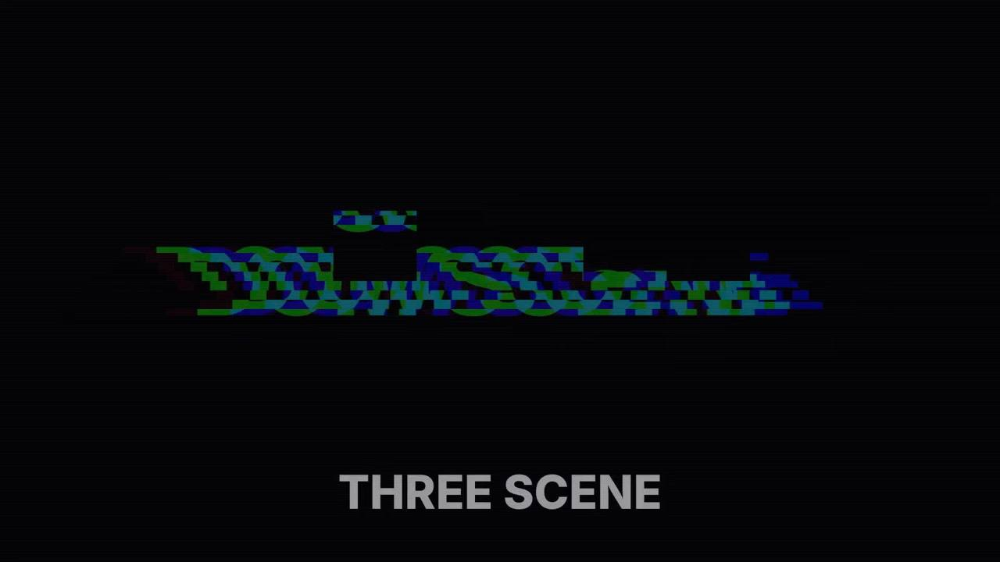
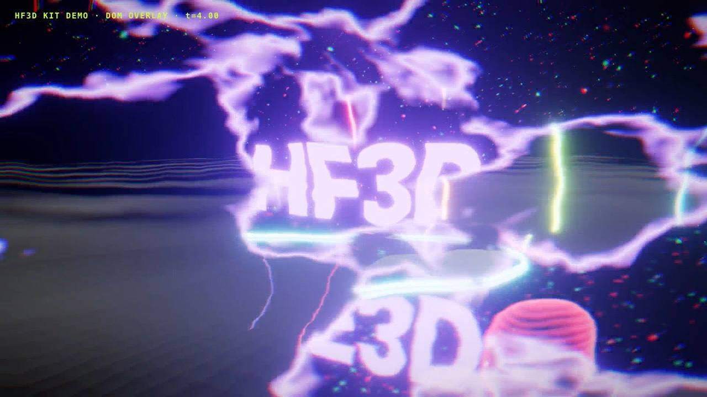

# hf3d: kit 3D (three.js) para HyperFrames

Kit reutilizável para cenas 3D a sério dentro de composições HyperFrames. Tem neon, reflexos, vidro, água, partículas GPU, luz volumétrica, gráficos 3D, câmaras com caminho, shaders custom e transições GLSL entre cenas. Tudo é guiado pelo tempo da timeline.

## Versões (exactas, em `package-lock.json`)

| Pacote | Versão | Publicada | Para quê |
|---|---|---|---|
| three | 0.186.1 | 2026-09-24 | motor 3D + addons `three/examples/jsm` (Reflector, Water, RoomEnvironment, RoundedBoxGeometry) |
| postprocessing (pmndrs) | 6.39.5 | 2026-09-09 | bloom (mipmap, selectivo por luminância), tone mapping ACES, aberração cromática, grain, vinheta |
| troika-three-text | 0.53.0 | 2026-07-24 | texto 3D SDF (neon, vidro, cromado) |
| three-custom-shader-material | 6.4.0 | 2025-10-12 | estender MeshPhysicalMaterial (holograma, água com deslocamento) |
| simplex-noise | 4.0.3 | 2024-07-26 | ruído em JS (o ruído em GLSL está em `src/noise.js`) |
| esbuild (dev) | 0.28.2 | 2026-08-08 | gera `dist/hf3d.mjs` |

Avaliação do three-custom-shader-material: **serve, e é usado.** Com `csm_Emissive` e `csm_Position`/`csm_Normal` estende o MeshPhysicalMaterial sem perder PBR, env, transmissão e clearcoat. Cuidado: o `csm_FragNormal` só existe em materiais com `normalMap`. Por isso a água pequena desloca vértices em vez de mexer no fragmento.

## Instalar e construir

```bash
cd packages/three-kit
npm ci             # instala exactamente o que está no lock
npm run build      # -> dist/hf3d.mjs (um só ESM, ~2.6 MB, sem CDN em render)
npm run fonts      # descarrega Inter e JetBrains Mono (.woff/.woff2, SIL OFL) para fonts/
npm run demo       # prepara examples/demo/assets e renderiza o demo (8 s) com o HyperFrames
```

Num projecto HyperFrames, copiar `dist/hf3d.mjs` e as fontes `.woff` de `fonts/` para `assets/` do projecto. O `dist/` e o `fonts/` não são versionados: geram-se com os comandos acima. O troika lê `.woff`/`.ttf`, não `.woff2`. Depois:

```html
<script type="module">
  import * as K from "./assets/hf3d.mjs";
  const { THREE } = K;
</script>
```

Exemplo completo e testado: `examples/demo/index.html` (8 s, 2 cenas e uma transição `warp`). Para um vídeo inteiro com 11 cenas, voz e música, ver o template `templates/showcase-3d/` na raiz do repositório.

## A regra do determinismo (não negociável)

1. **O único tempo é o `t` da timeline.** Nada de `requestAnimationFrame`, `setAnimationLoop`, `clock.getDelta()`, `Date.now()` nem `performance.now()`.
2. **Tudo é função fechada de `t`.** As partículas calculam a posição no vertex shader a partir de atributos com semente e de `uTime`. As faíscas usam `v·dt + g·dt²`. Não há simulação com estado, porque os workers do render pedem frames fora de ordem.
3. **Aleatoriedade só com semente.** Usar `K.rng(seed)` (mulberry32) e `K.hash(n)`. O flicker do neon (`K.flicker(t, seed)`) é função do número do frame.
4. **Pós-processo com tempo fixo.** O `Stage.render` define `fullscreenMaterial.time = t` e chama `composer.render(0)`, o que torna o grain determinístico. O `GlitchEffect` do postprocessing usa `Math.random`, por isso não se usa. O glitch está em GLSL em `transitions.js`.
5. **Esperar pelo que é assíncrono.** Fontes troika (`text3d(...).ready`), compilação de shaders (`stage.warm()`) e tudo o mais registam-se em `window.__hf.buildReady[...]`, criado em script clássico ANTES do módulo (ver o demo).

## O problema do WebGL preto: o que funcionou

**Causa.** As transições shader do HyperFrames (`@hyperframes/shader-transitions`) capturam cada cena DOM para textura. Um `<canvas>` WebGL dentro de uma cena é capturado vazio (preto), mesmo com `preserveDrawingBuffer: true`. Prova: `docs/proof-v1-hypershader-webgl-black.jpg` (spike da v1, a meio de um glitch: o torus 3D da cena seguinte não aparece). Quando o canvas está fora das cenas, quem desaparece durante a transição são as camadas DOM e o próprio canvas, porque o canvas do shader tapa tudo.

**Solução A (recomendada, usada na v2): um só canvas WebGL e transições DENTRO do GL.**
- Todas as cenas 3D vivem num `Stage` (um WebGLRenderer).
- Numa transição, o `Stage` renderiza a cena A e a cena B para render targets HDR e mistura-as num `TransitionPass` GLSL. Há 12 tipos: `fade glitch zoom iris warp whip flash ripple pixel burn swirl slices`.
- Só depois vem o pós-processo.
- Não há captura de DOM, por isso nada sai preto. O HUD e as legendas DOM ficam por cima do canvas e nunca desaparecem.
- Prova: `docs/proof-live-gl-t4.0.jpg`, que é o meio de uma transição `warp` com a cena de vidro e neon a dissolver-se para a cena de água, e o HUD DOM visível.

**Solução B (alternativa, provada na v1): pré-renderizar a cena 3D para MP4 e embebê-la como `<video class="clip">`.** Os vídeos são capturados bem pelas transições shader do HyperFrames. Usar quando for preciso misturar 3D com as transições DOM do HyperShader.

## API

`Stage` (`src/stage.js`)
- `new Stage({canvas, width, height, bloom:{intensity, threshold, smoothing, radius}, chroma, grain, vignette, samples})`
- `stage.add(name, {scene, camera, update(t)})`: o `scene.environment` fica com o PMREM RoomEnvironment se não tiver outro.
- `stage.warm()`: compila shaders.
- `stage.render(t, a, b?, mix?, type?, fx?)`: `type` é um nome de `TRANSITIONS`. `fx` aceita `{chroma, bloom}` por frame, por exemplo um pulso no beat.

Neon (`src/neon.js`)
- `neonTube(curve|Vector3[], {color, radius, intensity, closed, glass})`: núcleo emissivo HDR mais casca de vidro. Tem `.setProgress(p)` (desenhar-se) e `.setIntensity(k)`.
- `text3d(str, {font, size, color, mode:"neon"|"glass"|"chrome", intensity})` devolve `{mesh, ready}`.
- `flicker(t, seed)` e `hdr(color, k)`.

Reflexos e materiais (`src/materials.js`)
- `mirrorFloor({size, base, strength, blur, fade, resolution})`: Reflector HDR com blur e fade radial. Os reflexos do neon também fazem bloom.
- `glass({tint, thickness, iridescence, ior, dispersion})`: MeshPhysicalMaterial com transmissão, clearcoat, iridescência e dispersão.
- `chrome()` e `gloss({color, emissive})`.
- `hologram({color, intensity})`: CSM com fresnel, scanlines e ruído. Actualizar com `mat.uniforms.uTime.value = t`.
- `rippleWater({color, drops:[[x,y,t0]], amp, env, transmission})`: CSM com ondas concêntricas e gotas. Usar com `RingGeometry(0.001, r, 160, 80)`. Num balde pequeno, baixar `env` e `transmission`, porque o RoomEnvironment é cinzento claro e a água fica leitosa.

Água (`src/water.js`)
- `waterPlane({size, color, sunColor, distortion, speed})`: addon Water com normal map gerado em código. `update(t)`.
- Dica: cor e sol escuros (por exemplo `sunColor: 0x222222`), senão a água fica cinzenta.

Partículas (`src/particles.js`)
- `particleField({count, seed, mode:"field"|"sphere"|"tunnel", spread, colors, size, intensity, speed})`
- `curveFlow(curve, {count, radius, speed, colors})`: luz a correr dentro de um tubo. `update(t, {span})` limita o comprimento.
- `sparkBurst({t0, speed, gravity, life})`: explosão em função fechada do tempo.
- `textPoints(text, {font, width, height, step, scale, max})`: alvos 3D amostrados de texto num canvas 2D. A fonte CSS tem de estar carregada antes, com `document.fonts.load`.
- `morphParticles(targets, {radius, colors, size})` com `.update(t, p)`: nuvem que se monta no texto. Cada partícula tem o seu atraso.

Luz (`src/light.js`)
- `lightBeam({color, height, top, bottom, intensity})`: cone volumétrico falso com ruído. Faz de god rays com várias cenas.
- `glowSprite({color, size, intensity})`

Gráficos (`src/charts.js`)
- `bars3d(values, {colors})` com `.update(p)`: barras de vidro com núcleo neon, crescimento com stagger e ease back.
- `line3d(points, {color})` com `.update(p)`.

Câmara (`src/camera.js`)
- `cameraPath(camera, points, target|targets)` com `.at(u, {shake, t})`: CatmullRom com ease e tremor determinístico.
- `orbit(camera, {center, radius, height, a0, a1})` com `.at(u)`.
- `cameraKeys(camera, [[t, [px,py,pz], [tx,ty,tz]], ...])` com `.at(t, {shake, drift})`: poses no tempo com ease. Repetir uma pose faz um hold. É a forma recomendada para acertar a câmara com a narração.

Helpers (`src/core.js`)
- `rng`, `hash`, `prog(t,t0,d)`, `ease*`, `beatPulse(t, beat0, beat)`
- `bindTimeline(tl, duration, render)`: proxy tween que chama `render(t)`. Não rouba o `onUpdate` da timeline.
- `holdUntilReady(name, promise)`

## Workflow com o HyperFrames

1. `index.html` com `#root` (`data-duration` obrigatório) e `<canvas>` a 1920x1080 por baixo das camadas DOM: títulos, legendas, HUD.
2. Script clássico: cria `window.__hf.buildReady["hf3d"]` e a timeline GSAP pausada, e regista `window.__timelines["main"]`.
3. Script módulo: importa `assets/hf3d.mjs`, monta as cenas com `stage.add` e liga `K.bindTimeline(tl, T, render)`. Quando as fontes estiverem prontas, faz `render(0)` e resolve o `buildReady`.
4. `npx hyperframes@0.8.181 lint` e depois `render`.
   - O render calibra o custo e pode baixar para 1 worker com cenas pesadas (cerca de 0,5 a 1,5 s por frame com Reflector, Water e bloom num M1 Pro).
   - Correr em background com log em ficheiro.
5. QA: extrair frames com `select=eq(n\,N)` e verificar `getextrema()`.

## Limites conhecidos

- Não há DOF nem god rays de pós-processo: precisam de depth de uma única cena e o Stage mistura duas. Substituídos por `lightBeam` e bloom.
- O Reflector e o Water renderizam a cena outra vez. Com 2 cenas em transição, o custo do frame duplica.
- O troika gera SDF num web worker. Esperar sempre por `ready`.

## Provas

| WebGL dentro de uma cena + transição DOM do HyperShader (v1): sai preto | Stage único com transição em GLSL (kit): HUD DOM visível a meio da transição |
|---|---|
|  |  |
